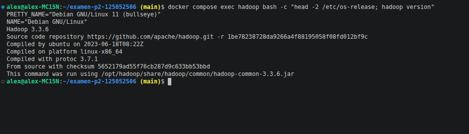
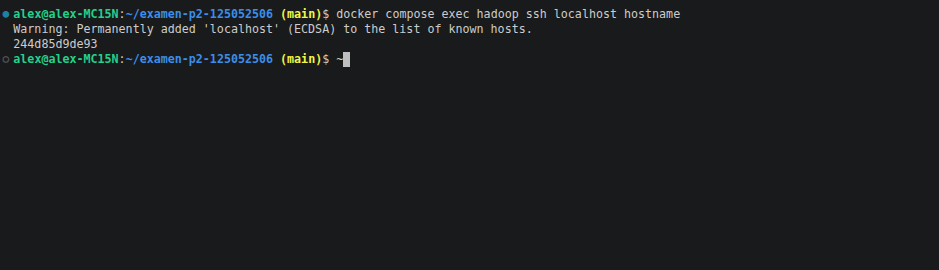
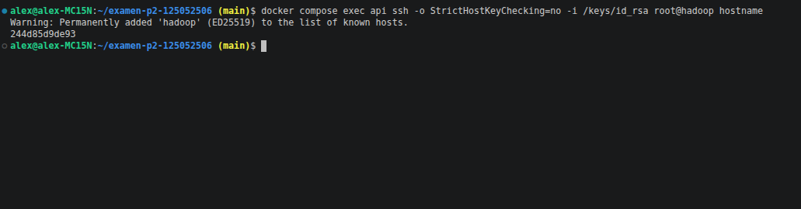
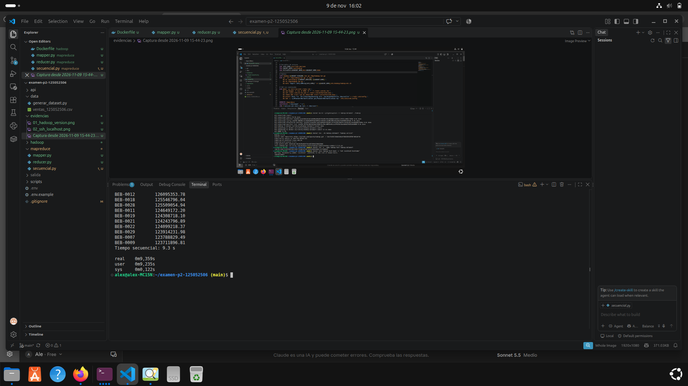
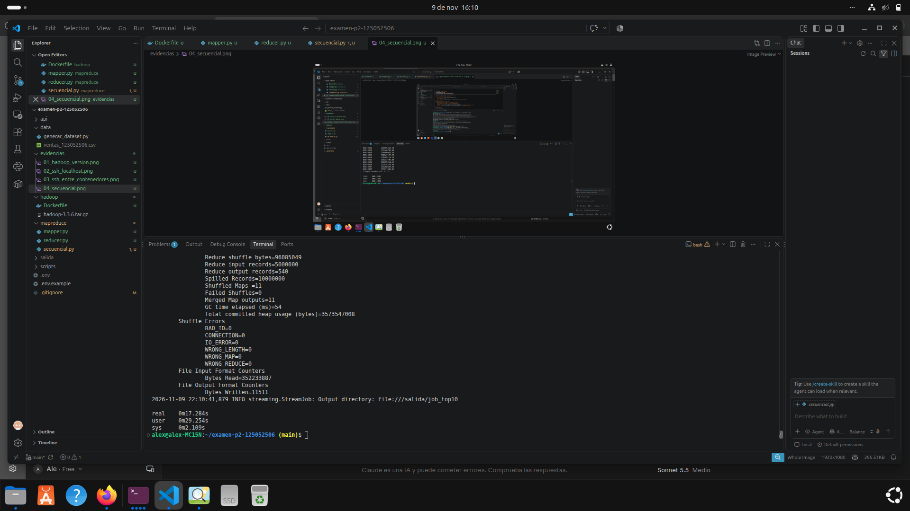
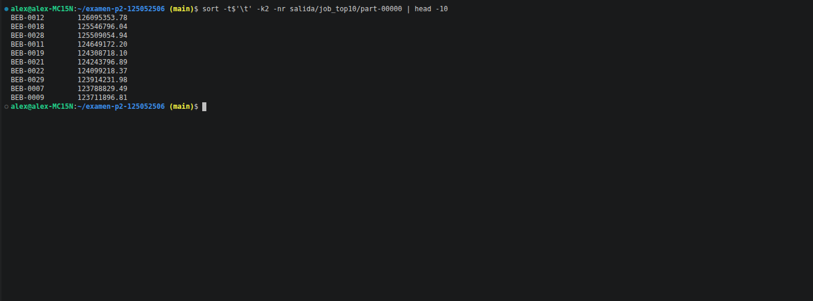
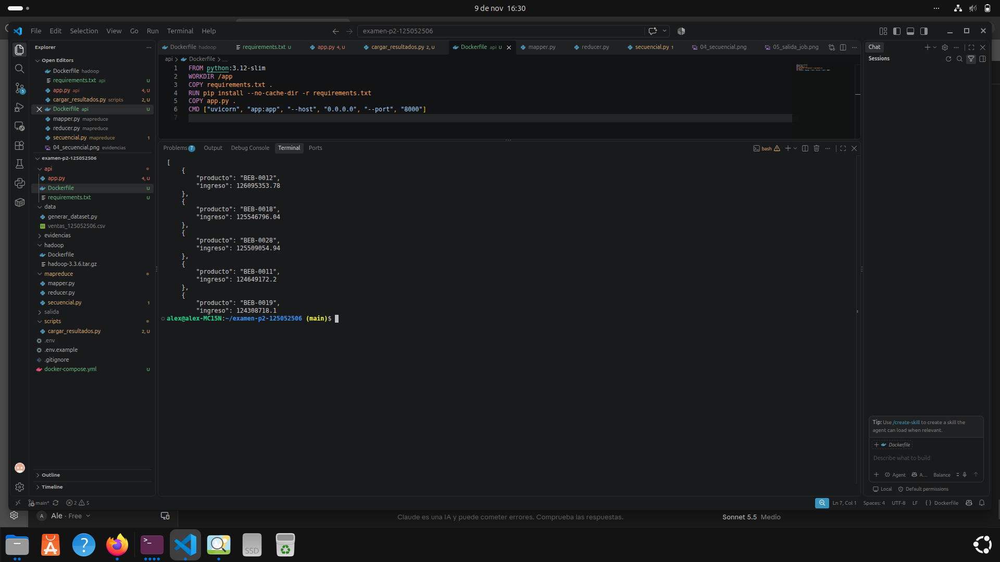
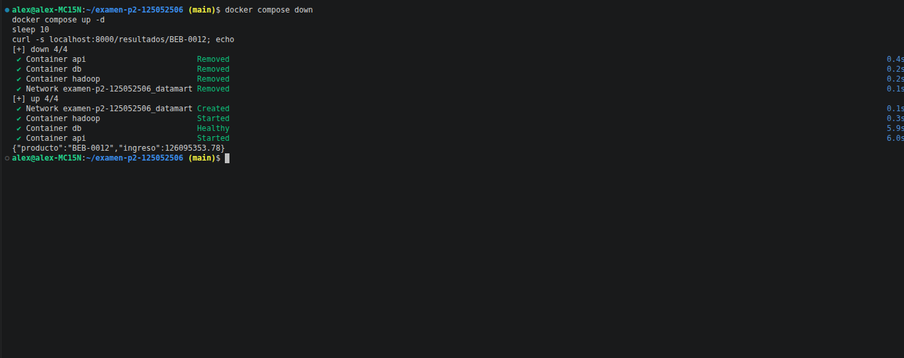

# Examen P2: Pipeline Hadoop + PostgreSQL + API (Docker)

**Matrícula:** 125052506
**Pregunta asignada (último dígito 6):** Top 10 productos por ingreso total en todo el año (ingreso = cantidad x precio_unitario).

## Cómo reproducir

1. Clonar y preparar variables:

```bash
git clone https://github.com/Alejandro-Jimenez-Reyes/examen-p2-125052506.git
cd examen-p2-125052506
cp .env.example .env     # editar POSTGRES_PASSWORD
```

2. Generar el dataset (no se sube al repo):

```bash
cd data && python3 generar_dataset.py 125052506 && cd ..
```

3. Levantar el ambiente:

```bash
docker compose up --build -d
```

4. Ejecutar el job de MapReduce (Hadoop Streaming, modo local):

```bash
docker compose run --rm hadoop "rm -rf /salida/job_top10 && time hadoop jar \$HADOOP_HOME/share/hadoop/tools/lib/hadoop-streaming-3.3.6.jar \
  -D mapreduce.framework.name=local -D fs.defaultFS=file:/// \
  -files /mapreduce/mapper.py,/mapreduce/reducer.py \
  -mapper 'python3 mapper.py' -reducer 'python3 reducer.py' \
  -input file:///data/ventas_125052506.csv -output file:///salida/job_top10"
sort -t$'\t' -k2 -nr salida/job_top10/part-00000 | head -10 > salida/top10.tsv
```

5. Cargar resultados y consultar la API:

```bash
docker compose exec api python /scripts/cargar_resultados.py /salida/top10.tsv
curl -s localhost:8000/top
```

## Endpoints

| Método | Ruta | Descripción |
|---|---|---|
| GET | / | Estado |
| GET | /top | Top 10 productos por ingreso |
| GET | /producto/{codigo} | Ingreso de un producto |
| POST | /producto | Inserta o actualiza un producto |

## Tiempos medidos (5 millones de registros)

| Método | Tiempo |
|---|---|
| Secuencial (Python) | ~8.8 s |
| Hadoop Streaming (local, en Docker) | ~17.3 s |

Ambos dan el mismo resultado (1.º BEB-0012 con 126095353.78).

**Explicación:** en una sola máquina Hadoop es más lento porque paga el arranque de la JVM, la ejecución de mapper y reducer como procesos externos, la serialización, el shuffle/sort y la escritura de archivos intermedios. Su ventaja aparece al escalar a muchos nodos con datos que no caben en un solo equipo. Con 336 MB, el script secuencial es más eficiente.

## Evidencias










## Teoría (Parte A)

**CMD vs ENTRYPOINT:** ENTRYPOINT define el ejecutable fijo del contenedor; CMD da el comando o argumentos por defecto y se sobrescribe con `docker run imagen comando`. Si hay ambos, CMD se pasa como argumentos de ENTRYPOINT.

**COPY vs ADD:** COPY solo copia archivos locales. ADD además descomprime tar locales y puede descargar URLs; por eso se prefiere COPY.
